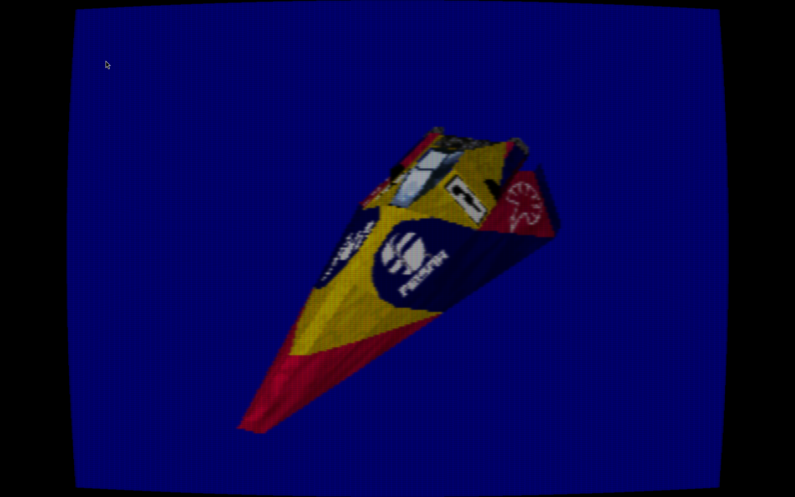

# psss

Experimenting with Sony PSX

The repo has some small MIPS assembly toys (a triangle renderer and a simple program to divide numbers), these are in the `./asm/` directory and can be built using `make build_asm_draw` or `make build_asm_divide`. More info on the dependencies can be found in the `Makefile`

The repo also has a `C` program which interfaces with the PSX SDK, `PSn00bSDK`. Is has a lower level API compared to the original `PsyQ` SDK and works on modern systems.
The code is in the `./game` directory and can be built using `make build`.
Depending on when you read this, the program is either a toy which just draws primitives or a playable demo game.

